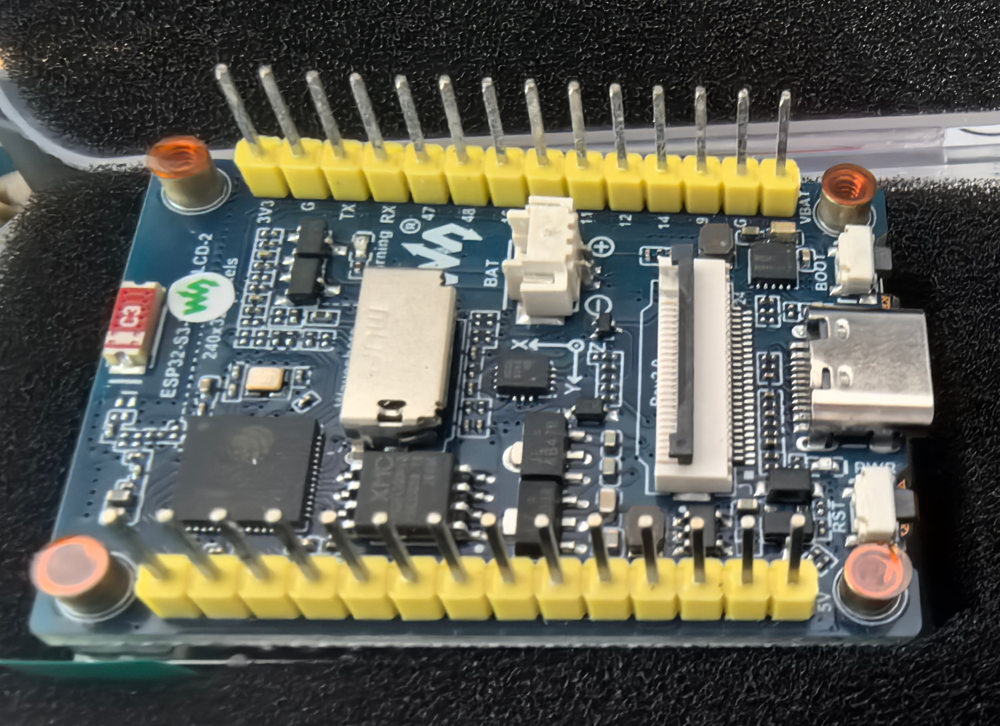
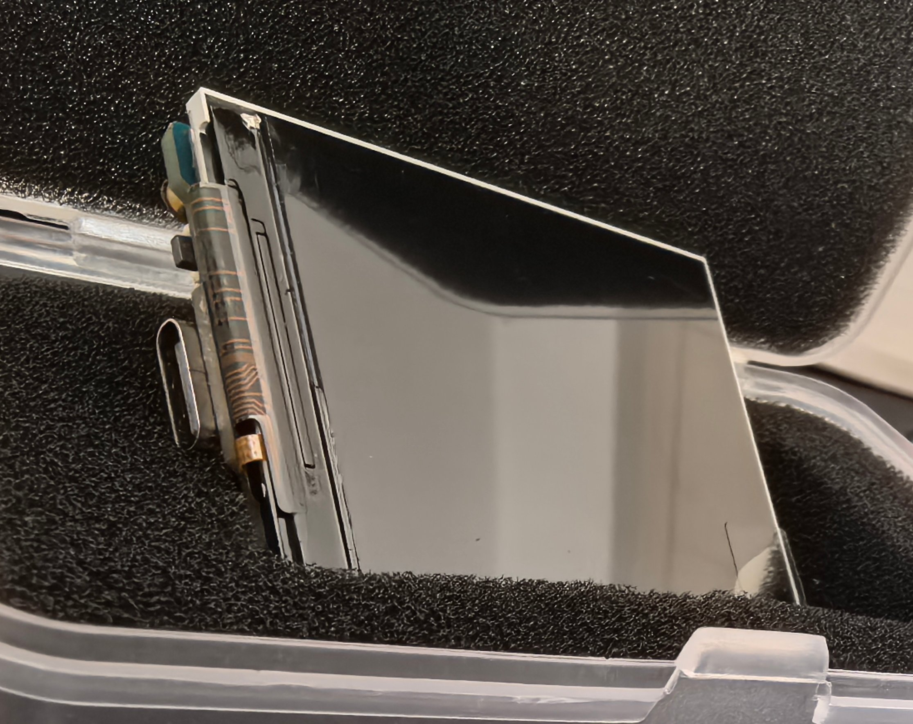
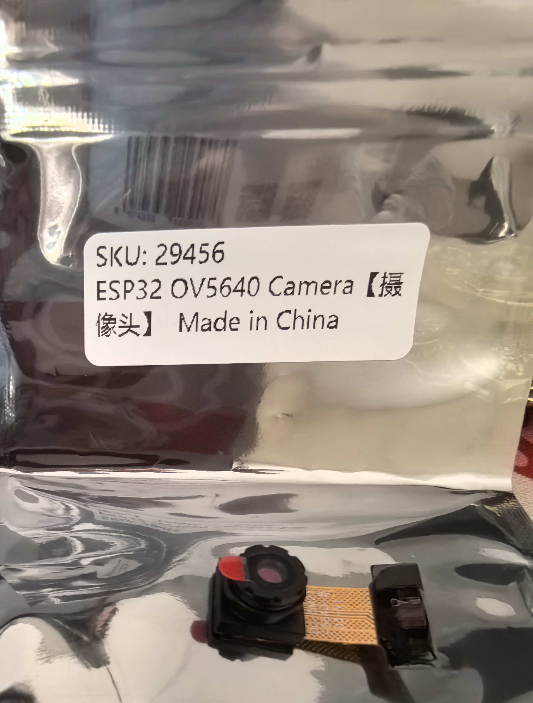
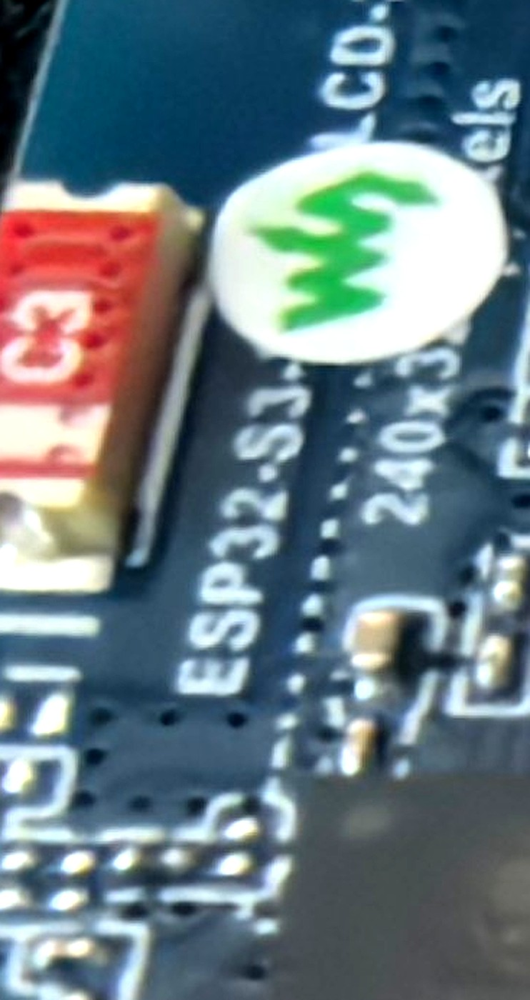
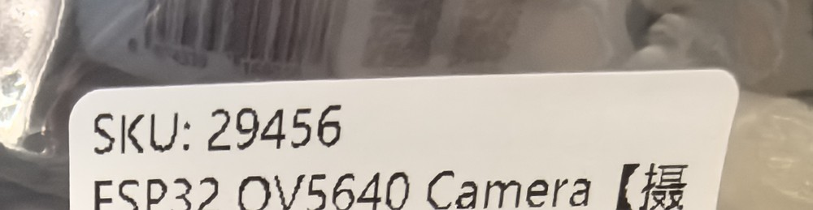
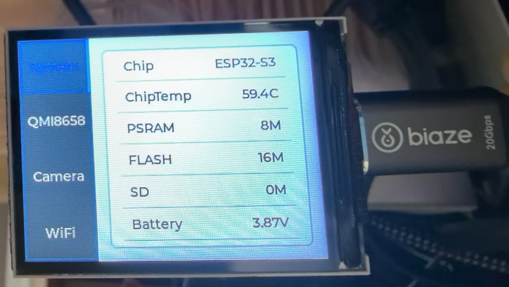
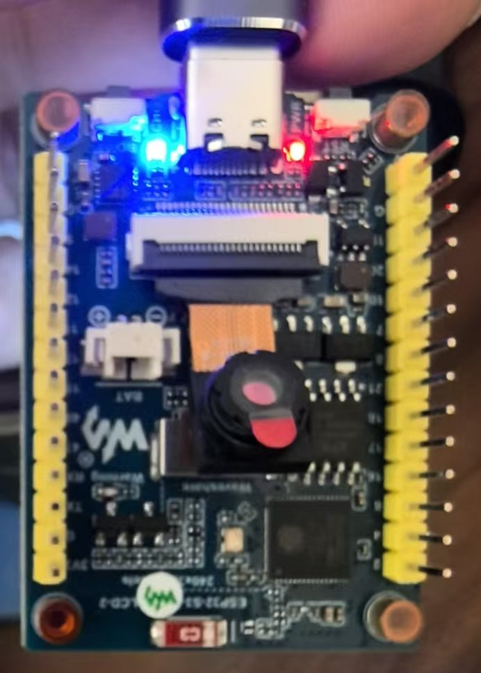
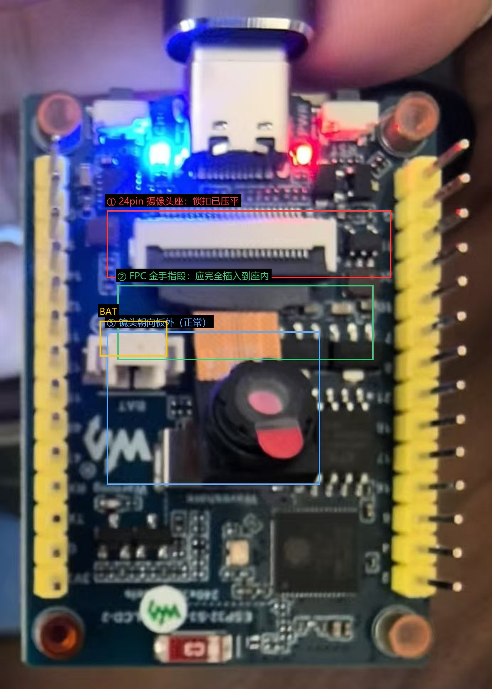
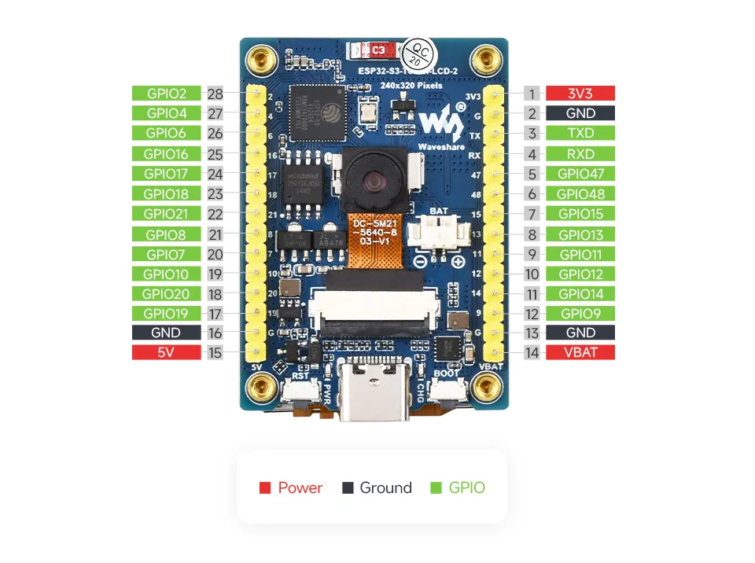

# 2026-10-31　设备到货 · 首次开机确认

| 项目 | 内容 |
| --- | --- |
| 项目 | ESP32 嵌入式开发 |
| 日期 | 2026-10-31（周六） |
| 时段 | 13:08 – 14:15（GMT+8） |
| 主题 | 收板 → 建档 → 认设备 → 确认电脑能连上 |
| 硬件 | 微雪 Waveshare **ESP32-S3-LCD-2**（2 寸 IPS 240×320） |
| 主机 | Windows（`E:\ESP32开发`），Python 3.12，Git 2.45.1 |
| 状态 | 板子已连通（`COM16`），可读写 Flash；开发方案未定 |

---

## 一、起点：今天对话开始前的原始情况

上午买回来的板子和配件刚拍完照，`E:\ESP32开发` 里**只有一个照片文件夹，没有 git、没有工具链、没有任何代码**：

```
E:\ESP32开发
└─ 设备图片\
   ├─ 板子屏幕与接口.jpg   3,227,979 B（修改时间 13:04:17）
   ├─ 板子正面照.jpg       3,168,029 B（修改时间 13:04:05）
   └─ 摄像头照片.jpg       2,291,065 B（修改时间 13:04:27）
```

当时对硬件一无所知：不知道主控型号、Flash 大小、有没有 PSRAM、屏幕尺寸、摄像头型号，也不知道电脑能不能认出来。

### 1.1 用户当时的原话（回合 #1）

> 我买了一块esp32的板子，相关设备的照片放在项目文件夹里面了，你先把这个项目文件夹用git管理起来，然后看看设备照片确认下设备信息，接着看看电脑现在已经链接上这个板子了，能不能访问到这块板子

### 1.2 现场照片

**板子正面（开箱状态，透明盒 + 防静电海绵）**



**另一块屏幕模块（裸屏 + FPC 排线，单独装盒）**



**摄像头（银色防静电袋）**



**板载丝印特写：`ESP32-S3-…` + 微雪 "W" 标**



**摄像头包装标签：`SKU: 29456` / `ESP32 OV5640 Camera`**



---

## 二、时间线

| 时间 | 动作 | 结果 |
| --- | --- | --- |
| 13:04 | 用户拍完照片落盘 | `设备图片\` 三张原始照片 |
| 13:08 | 回合 #1 开始，勘查目录 | 只有照片，无 git / 无工具链 |
| 13:09 | `git init -b main` | 仓库建立，`core.autocrlf=true` |
| 13:10 | 逐张判读照片（含局部放大） | 认出微雪 "W" 标、`ESP32-S3-…240x…` 丝印、OV5640 标签 |
| 13:11 | 枚举串口 / USB 设备 | 发现 `VID_303A&PID_1001` 复合设备 → **COM16** |
| 13:13 | 建 `.venv`，装 `esptool 5.6.0` + `pyserial 3.5` | 可用 |
| 13:14 | `esptool flash-id` | **连接成功**：ESP32-S3 rev v0.2 / 8MB PSRAM / 16MB Flash |
| 13:15 | 复位抓串口启动日志 | 拿到 ROM 引导信息（app 静默） |
| 13:16 | dump 分区表 + app 描述符 + 3MB app 区 | 判明出厂固件身份（微雪 `01_factory` 演示） |
| 13:18 | 写 `README.md`、`docs\设备信息.md`、三个脚本 | 项目骨架成型 |
| 13:20 | 首次提交 `f3cb787` | 11 files, +433 |
| 13:24 | 回合 #2 开始：要求建立开发日志并上传 GitHub | 见第五节 |
| 13:32 | 发现工作区照片被外部程序压缩替换 | 从 git 恢复原件（详见 4.4） |
| 13:45 | 日志仓库创建并推送成功 | 远端 `esp32-embedded-devlog`（见 5.4） |
| 13:50 | 回合 #3：备份 Flash / 判读装机后照片 | 见第八节 |
| 13:51 | 整片 16 MB 备份完成 | 16,777,216 B，SHA256 已记（见 8.2） |
| 14:00 | 屏幕照片核对 | 屏显数据与实测逐条对上（见 8.3） |
| 14:05 | 摄像头照片高倍放大判读 | 锁扣已压平可确认；朝向/插深照片看不出（见 8.4） |

---

## 三、操作与证据（回合 #1）

### 3.1 目录与 git

```powershell
Get-ChildItem -Force
# d---- 设备图片      （仅此一项）

git --version
# git version 2.45.1.windows.1

git init -b main
# Initialized empty Git repository in E:/ESP32开发/.git/
```

### 3.2 串口 / USB 枚举（关键一步）

```powershell
Get-CimInstance Win32_SerialPort   # 蓝牙虚拟串口一堆，只有一个真串口：
```

| DeviceID | Name | PNPDeviceID |
| --- | --- | --- |
| COM16 | USB 串行设备 (COM16) | `USB\VID_303A&PID_1001&MI_00\7&1515E698&0&0000` |

同时枚举到同一块板子的第二个接口（PnP 设备）：

```
USB\VID_303A&PID_1001&MI_02   →  USB JTAG/serial debug unit
USB Composite Device 序列号   →  B8:1F:3F:C8:25:24
```

**判读**：`VID_303A` 是乐鑫（Espressif）的 USB VID，`PID_1001` 即 ESP32-S3 内置的 USB-Serial/JTAG。
一块板子出两个口 —— **COM16 走 CDC 串口**，另一个是 JTAG（可给 OpenOCD 用）。这同时也说明板子**不需要 CH340/CP2102 转串口芯片**，也没有插错线。

### 3.3 esptool 实测（确凿的芯片级证据）

```powershell
.\.venv\Scripts\python.exe -m esptool -p COM16 -b 460800 flash-id
```

```
Serial port COM16:
Connecting....
Detecting chip type... ESP32-S3
Chip type:          ESP32-S3 (QFN56) (revision v0.2)
Features:           Wi-Fi, BT 5 (LE), Dual Core + LP Core, 240MHz, Embedded PSRAM 8MB (AP_3v3)
Crystal frequency:  40MHz
USB mode:           USB-Serial/JTAG
MAC:                b8:1f:3f:c8:25:24

Flash Memory Information:
Manufacturer: 20
Device: 4018
Detected flash size: 16MB
Flash type set in eFuse: quad (4 data lines)
Flash voltage set by eFuse: 3.3V
```

### 3.4 串口启动日志（115200，复位抓取）

```
ESP-ROM:esp32s3-20210327
Build:Mar 27 2021
rst:0x15 (USB_UART_CHIP_RESET),boot:0xa (SPI_FAST_FLASH_BOOT)
Saved PC:0x4037bbce
SPIWP:0xee
mode:DIO, clock div:1
load:0x3fce2820,len:0x1188
load:0x403c8700,len:0x4
load:0x403c8704,len:0xbf0
load:0x403cb700,len:0x30e4
entry 0x403c88ac
```

二级引导正常执行后进入 app；该出厂固件**启动阶段不打印串口信息**（输出全在屏幕上）。

### 3.5 固件取证（判断出厂状态，为后续刷机留退路）

分区表（读自 `0x8000`）：

| 名称 | 类型 | 偏移 | 大小 |
| --- | --- | --- | --- |
| nvs | data/nvs | 0x009000 | 20 KB |
| otadata | data/ota | 0x00e000 | 8 KB |
| app0 (factory) | app/ota_0 | 0x010000 | 3072 KB |
| app1 | app/ota_1 | 0x310000 | 3072 KB |
| ffat | data/fat | 0x610000 | 10112 KB |
| coredump | data/coredump | 0xff0000 | 64 KB |

app 描述符（`0x10020`）：

```
project_name: arduino-lib-builder
app_version : 2f061cb
compile     : Jan  6 2025 12:12:43
idf_ver     : v5.3.2-282-gcfea4f7c98-dirty     （即 Arduino-ESP32 3.1.1）
```

app 区（3 MB）里的关键字符串：

```
/F:\project\ESP32-S3-LCD-2\code\01_factory\bsp_lv_port.cpp
bsp_lv_port_init / bsp_lv_port_task / app_camera_task / app_wifi_task / bsp_button_task
"SD Card Type: " / "No SD card attached" / OV5640 / OV2640 / waveshare0755
esp32:esp32:esp32s3:UploadSpeed=921600,USBMode=hwcdc,CDCOnBoot=cdc,...
```

**结论**：这是微雪出厂 `01_factory` 演示固件 —— LVGL 界面 + 摄像头 + SD 卡 + Wi-Fi（网页）演示，用 Arduino 框架编译。

---

## 四、设备最终结论

| 项目 | 结论 | 依据 |
| --- | --- | --- |
| 板卡 | 微雪 **Waveshare ESP32-S3-LCD-2**（2 寸版） | 丝印 + "W" 标 + 固件路径 + 器件布局 |
| 主控 | ESP32-S3 (QFN56) rev **v0.2** | esptool |
| 内核 | 双核 LX7 + LP 核，240 MHz | esptool Features |
| PSRAM | **8 MB**（内封，ESP32-S3R8） | esptool |
| Flash | **16 MB**，quad 4 线，3.3 V | esptool |
| 晶振 | 40 MHz | esptool |
| USB | 原生 USB-Serial/JTAG（**无需 CH340**） | `USB mode` + 设备树 |
| MAC | `b8:1f:3f:c8:25:24` | esptool |
| 屏幕 | 2.0″ IPS **240×320**，262K 色 | 丝印 `240x…` + 官方规格 |
| 摄像头 | **OV5640 500 万像素**，SKU 29456 | 包装标签 + 固件驱动 |
| 存储 | TF 卡座（SDMMC 4 线） | 卡座 + `SDMMC_CLK/CMD/D0-D3` |
| 其他 | BAT 电池座、U.FL 天线座、BOOT/RST、USB-C、双排排针 | 照片 |

### 4.1 引脚层面的信息缺口

固件里只留下 `SPI_MASTER_SCK/MISO/MOSI/SS`、`SDMMC_*`、`I2C_MASTER_SDA/SCL` 这类**常量名**，具体 GPIO 号已编译进代码，无法从字符串直接读出。
板上丝印可读到 `3V3 / G / TX / RX / 47 / 48 / … / VBAT`。
→ 精确引脚表后续以微雪官方 wiki 为准，或上电后用代码回读。

### 4.2 配件状态

- 屏幕：**未装**。2 寸裸屏在独立盒子里，PCB 上 40pin FPC 座是空的。
- 摄像头：**未装**。OV5640 带 24pin FPC，配板上 24pin 座，需断电插拔。
- 排针：上下两排黄色排针已焊好，可外接。

### 4.3 访问性结论

> **能访问，完全通。** 串口 `COM16` 可直接打开；`esptool` 能识别芯片、读分区表、读 3 MB 应用区、读 Flash ID；复位可抓启动日志。

### 4.4 意外事件：工作区照片被外部程序改写（已修复）

- 13:20 提交时照片为原始大小（3.17 MB / 3.23 MB / 2.29 MB）。
- 13:32 复查发现工作区里三张照片被替换成压缩版（805 KB / 976 KB / 443 KB），`git status` 显示 3 个 `M`。
- 不是本会话任何命令所为（PIL 裁剪结果写在临时目录和 `docs\img\`，不覆盖原图），推测是外部同步/图片优化工具所为。
- 处理：`git checkout -- 设备图片` 从首个提交恢复原件，哈希校验一致后重新复制到日志目录。
- **教训**：这类"原始证据"文件入库后要定期核对哈希；日志图片一律从 git 里的原件复制。

---

## 五、回合 #2：建立开发日志仓库

### 5.1 用户原话

> 是这样的，我现在还没想好要拿它做什么，但是希望把这个开发过程作为一个记录，放到GitHub上面去，形成一个嵌入式设备开发日志和项目仓库，我的github主页是 https://github.com/papercatno1 ，你先把我今天一开始和你对话开始的原始情况记录到文件种（含图片），并且后续每次对话都记录进去，当天工作结束后把这个记录上传到GitHub作为日志数据，后续确定开发方案之后再上传项目数据，日志和项目数据各自独立处理。这个日志归属于项目"ESP32嵌入式开发"

### 5.2 定下的规矩

- **两个独立仓库**：日志仓库（本文所在）与项目仓库（代码/工程，方案定了再推）。
- **日志颗粒度**：每次对话一个"回合"小节，追加到当天文件，只增不改写历史。
- **日志仓库存放位置**：`E:\ESP32开发\日志`（自己的独立 git 仓库，不并入项目仓库）。
- **上传时机**：当天工作结束统一 commit + push。

### 5.3 GitHub 通道排查

| 检查 | 结果 |
| --- | --- |
| `gh` CLI | 未安装 |
| HTTPS 凭据 | 存了一个 `ghp_` 令牌，但 `GET /user` 返回 **401**（已失效） |
| SSH 22 端口 | `Connection closed by 20.205.243.166 port 22`（被拒） |
| **SSH 443 端口** | ✅ `Hi papercatno1! You've successfully authenticated` |

处理：把 `~/.ssh/config` 里 `Host github.com` 改为走 `ssh.github.com:443`（原配置备份为 `config.bak.20261031`），
git 全程用 SSH，无需令牌。

**遗留**：GitHub 不允许中文仓库名，仓库名取 ASCII（`esp32-embedded-devlog`）；仓库本身需要在网页上手动创建一次，
之后 `scripts\push_log.ps1` 一条命令即可推送。

### 5.4 上传结果（已推送）

用户在网页上创建空仓库后，13:45 首次推送：

```
$ git push -u origin main
branch 'main' set up to track 'origin/main'.
To github.com:papercatno1/esp32-embedded-devlog.git
 * [new branch]      main -> main
```

校验（`ls-remote` + `fetch` 双向对照）：

```
43a374666f5ecbbe38e2a35ff797bfa01efcd75b    HEAD
43a374666f5ecbbe38e2a35ff797bfa01efcd75b    refs/heads/main
本地 HEAD == origin/main         ✔
```

远端文件清单 10 个（README、记录规范、模板、当天日志、5 张图片）全部到位。

> 捎带记一笔网络现象：`ssh.github.com` 在本机解析会在 `20.205.243.x` 和一个 `198.18.1.67`（保留网段）之间跳，
> 偶尔出现 `Connection closed by 198.18.1.67 port 443`；重试即恢复。属本机 DNS/代理抖动，与仓库权限无关。

---

## 六、当天产物

### 6.1 项目仓库 `E:\ESP32开发`（提交 `f3cb787`）

```
.gitignore
README.md
docs/设备信息.md
docs/img/板载丝印-ESP32-S3.jpg
docs/img/摄像头包装标签-OV5640.jpg
scripts/chip_info.ps1        一键探测（端口/芯片/Flash/分区）
scripts/serial_monitor.py    串口监视 + 复位抓日志
scripts/fw_inspect.py        固件离线分析（分区/app 描述符/关键词串）
设备图片/×3
```

本地产物（已 gitignore）：`.venv`（esptool 5.6.0 + pyserial 3.5）、`dump/`（分区表、app 头 320 KB、完整 app 3 MB）、`logs/`（串口日志）。

### 6.2 日志仓库（本仓库）

```
README.md
记录规范.md
templates/每日日志模板.md
2026-10-31/日志.md
2026-10-31/图片/×5
```

---

## 七、遗留问题与下一步

**遗留**

1. ~~屏幕和摄像头都还没装~~ → 屏幕已装好并点亮（回合 #3），摄像头已装、功能待验证。
2. LCD / 摄像头 / 触摸的精确 GPIO 映射尚未确认（等官方 wiki 或实测）。
3. ~~整片 16 MB Flash 备份还没做~~ → 已于 13:51 完成并校验（回合 #3）。
4. ~~GitHub 日志仓库未创建~~ → 已于 13:45 创建并推送成功（见 5.4）。

**待定（用户：还没想好拿它做什么）**

- 候选方向：LVGL 界面点屏 / OV5640 拍照 + Wi-Fi 图传 / SD 卡录像 / 桌面小电视 / 智能家居终端 / 便携气象站
- 方案确定后再建项目仓库并推代码；日志继续按天记。

---

## 八、回合 #3：Flash 备份 · 屏幕点亮 · 摄像头安装（13:50 – 14:15）

### 8.1 用户原话

> 1、帮我备份flash，2、我已经将摄像头接入板子了，但不确定对不对，3、屏幕与板子其实已经链接好了，目前显示信息了，但这个屏幕不是触摸屏，暂时没法操作。摄像头和屏幕的照片也都放到项目的"设备图片"文件夹了。你看一下

新增两张照片：`摄像头连接图.jpg`（13:49:20）、`屏幕显示图.jpg`（13:49:50）。

### 8.2 整片 Flash 备份（完成）

```powershell
.\.venv\Scripts\python.exe -m esptool -p COM16 -b 921600 read-flash 0x0 0x1000000 dump\full_flash.bin
```

```
Reading from 0x01000000 ===== 100.0% 16.00MB/16.00MB [1:18]
Read 16777216 bytes from 0x00000000 in 78.1 seconds (1718.3 kbit/s) to 'dump\full_flash.bin'.
```

| 项目 | 结果 |
| --- | --- |
| 大小 | 16,777,216 B（正好 16 MB，无截断） |
| SHA256 | `31BA1ECFA88164E83FD674F725B293085C422DF2CEBB6BBC7B218790338E12FD` |
| 耗时 | 78.1 s，实测 1718.3 kbit/s |

**三重自检**：

1. `0x0` 起为 `e9 04 02 4f` —— ESP 镜像魔数，二级引导在位。
2. `0x8000` 分区表解析正常：`nvs / otadata / app0 / app1 / ffat / coredump`。
3. `0x10000–0x310000`（app0）与上午单独 dump 的 `dump\app0.bin` **SHA256 完全一致** —— 两次独立读取互相印证。

→ 记录归档到项目仓库 `docs\固件备份.md`（大小 / 哈希 / 恢复命令 / 校验方法）。
→ 提醒：`dump\` 已被 gitignore，**这份备份只在本机一份**，建议另行拷贝到别的磁盘或网盘。

### 8.3 屏幕：确认正常

照片 `屏幕显示图.jpg` 拍的是出厂 demo 的 System 页。屏上内容与 esptool 实测逐条对上：



| 屏幕显示 | 实测 | 结论 |
| --- | --- | --- |
| Chip `ESP32-S3` | ESP32-S3 (QFN56) rev v0.2 | ✔ |
| `PSRAM 8M` | Embedded PSRAM 8MB | ✔ |
| `FLASH 16M` | Detected flash size: 16MB | ✔ |
| `SD 0M` | 未插 TF 卡 | ✔ 符合预期 |
| `ChipTemp 59.4C` | 板子在跑 LVGL | 温升正常 |
| `Battery 3.87V` | 板载 ADC 电池检测 | 观察项：USB 供电下仍是 3.87V |

- 左栏四项：`System / QMI8658 / Camera / WiFi`。
- **新发现**：板上还有 **QMI8658 六轴 IMU**（固件里对应 `qmi8658_task`），后续可做姿态/摇一摇类交互。
- 判定：**40pin LCD FPC 接对了**，屏、背光、时序全部正常。屏幕无触摸，交互只能靠 BOOT 键 / 串口 / 网络。

### 8.4 摄像头：已装，但照片无法定论（需功能验证）

照片 `摄像头连接图.jpg` 判读（标注版见 `08-摄像头连接-标注.jpg`）：





**能确认的**

- OV5640 的 24pin FPC 已插进板载 24pin 座，排线走势顺，无折痕、无翘边。
- 与装机前的 `板子正面照.jpg` 对比：该座的**黑色锁扣由"立起"变成"压平"**，说明锁扣已压下。
- 板子带电运行（蓝灯电源 + 红灯运行），屏正常显示，说明插拔过程中没弄坏板子。

**照片看不出来的**

- **金手指朝向**：FPC 金手指必须对着座内触点，反插照样能塞进去，肉眼在照片上分辨不出。
- **是否插到底**：FPC 顶端到座内限位的那 0.5~1 mm，手机微距也拍不清。

**判定办法（两种，任选）**

1. **零成本**：按一下板上的 `BOOT` 键，看出厂 demo 会不会切到 `Camera` 页。
   若显示实时画面 → 接对了；若是黑屏/提示相机初始化失败 → 朝向反或没锁紧。
   （微雪无触摸机型的 demo 常用 BOOT 切页，但不保证，按了没反应就换方案 2。）
2. **确定性**：装 Arduino CLI / PlatformIO，烧一个二十行的 `esp_camera_init` 自检固件，串口打印
   `Camera probe failed with error 0x…` 或 `Detected camera not supported` 就能直接定位。
   OV5640 的 SCCB 地址是 `0x3C`，扫不到就是没连上。

**风险评估**：FPC 插反不会烧板子，最坏结果是相机不工作；断电后再插拔即可，可放心折腾。

### 8.5 本回合结论

- 备份：✅ 完成 + 三重校验，出厂状态可回滚。
- 屏幕：✅ 确认正常，LCD 链路验证通过。
- 摄像头：⚠️ 物理上已装、锁扣已压，但"对不对"要靠一次初始化验证才能定论。
- 新增待办：摄像头自检；QMI8658 可作为一个现成的传感器卖点。

---

## 九、回合 #4：屏幕照片的额外信息 · 工具链规划（14:15 – 14:40）

### 9.1 用户原话

> 这张图里面有camera页，但是我不能操作，所以不知道怎么看实时画面，你看看这个信息有帮助吗？另外工具链你可以先给我规划一下，后续开发要用到哪些功能我可以怎么开发

### 9.2 那张屏幕照片确实有用：它逼我去翻了固件的 UI 文案表

既然是同一份固件，界面上每个字都必然躺在 Flash 里。于是在整片备份 `dump\full_flash.bin` 里搜 UI 文案，`0x1039e` 处挖到一整张字符串表：

```
system_task | app_wifi_task | System | QMI8658 | Camera | WiFi
accel_x | 0.00 | accel_y | accel_z | gyro_x | gyro_y | gyro_z
Chip | ESP32-S3 | ChipTemp | 0.0C | PSRAM | FLASH | SD | Battery | 0.0V
WiFi STA Setting | 0.0.0.0 | PASS | No data
```

**读出来的信息**：

1. 左栏四页对应四个任务：`system_task`、`app_wifi_task`，以及 QMI8658 的 `accel_/gyro_` 六个量、`ChipTemp / PSRAM / FLASH / SD / Battery` 这组系统信息。
2. `WiFi STA Setting` + `0.0.0.0` → Wi-Fi 页是**在屏上输 SSID/密码**的 STA 配置页，**不是热点**，所以没有"连上去看网页"这条路。
3. 这套 UI 是**触摸驱动**的（跟触摸版固件共用一套），本机屏无触摸 → 左栏点不动，Camera 页进不去。

顺手扫了 NVS 分区（`0x9000–0xE000`），发现微雪工厂测试残留的 Wi-Fi 凭据：

```
sta.ssid = WSTEST
sta.pswd = waveshare0755
```

——是他们自家测试路由的名字（`waveshare0755` 就是之前字符串里那个），这里用不上，别指望连它。

### 9.3 结论：想看出实时画面，只有两条路

| 办法 | 成本 | 确定性 |
| --- | --- | --- |
| 按一下 `BOOT` 键，看 demo 会不会翻页 | 1 分钟，零风险 | 低（这套 UI 是点按式的，很可能没响应） |
| **烧一个 `esp_camera_init` 自检固件**，串口打印结果 | 半天（含装工具链） | **100%**，顺带把 M2 里程碑完成 |

→ 因此结论并入工具链规划：**摄像头验证放在 M2，用自检固件一次定论**，不再依赖"看 demo 页面"。

### 9.4 环境体检（决定方案前先摸清家底）

| 项目 | 结果 |
| --- | --- |
| VS Code | ✅ 已装 `C:\Users\nuc\AppData\Local\Programs\Microsoft VS Code` |
| Cursor | ✅ 已装 `C:\Program Files\cursor`（VS Code 内核，扩展通用） |
| Python | ✅ 3.12.4，已有 `.venv`（esptool + pyserial） |
| 磁盘 | C: 308 GB / D: 1148 GB / E: 1735 GB 空闲 |
| `downloads.arduino.cc` | ✅ 200 |
| `espressif.github.io/arduino-esp32/package_esp32_index.json` | ✅ 200（可直连拉 esp32 core） |
| `dl.registry.platformio.org` / `api.registry.platformio.org` | ✅ 200（PIO 可用） |
| `dl.espressif.com/.../esp-idf-v5.3.2.zip` | ❌ 404（要装 IDF 得走安装器或镜像） |
| GitHub API | ⚠️ 未认证限流 403（不影响下载，影响 API 查询） |
| 本机 Wi-Fi | 硬件在（Killer AX1690i），**软件关闭**；做无线上位机测试前要打开 |

### 9.5 方案定稿：PlatformIO + Arduino 框架

三条路线对比后选 A（完整对比写进 `docs\工具链方案.md`）：

| | A. PlatformIO（选它） | B. Arduino CLI | C. ESP-IDF |
| --- | --- | --- | --- |
| 配置可版本化 | ✅ `platformio.ini` 进仓库 | ❌ 命令行参数易丢 | ✅ `sdkconfig` |
| 上手速度 | 快 | 最快 | 慢 |
| 生态 | Arduino 库全自动拉 | 同 | 官方组件，最底层 |
| 体积 | ~1.5–2 GB | 同 | ~3 GB |

**选它的理由**：出厂固件本就是 Arduino-ESP32 3.1.1 编的，走 Arduino 生态最贴近现成 demo；
`platformio.ini` 能把板型/Flash 布局/PSRAM/USB CDC 全写进仓库，符合"项目数据独立管理"；
真要抠 DMA、LCD_CAM 性能，同工程把 `framework` 换成 `espidf` 即可。

关键编译参数（从出厂固件 FQBN 抄的，保证烧完还能用 `COM16` 看日志）：

```ini
-DARDUINO_USB_MODE=1  -DARDUINO_USB_CDC_ON_BOOT=1
; 出厂固件原值: USBMode=hwcdc,CDCOnBoot=cdc,UploadMode=cdc,UploadSpeed=921600
```

### 9.6 功能地图与里程碑

功能 → 用什么库，一张表说清（详见文档第三节）：

| 功能 | 方案 | 难点 |
| --- | --- | --- |
| 显示 | `Arduino_GFX` / `LovyanGFX` + **LVGL 9** | 驱动 IC 型号待确认；双缓冲 240×320×2B ≈150 KB/帧，吃 PSRAM |
| 摄像头 | `esp32-camera`，OV5640 硬件 JPEG | 缓冲必须放 PSRAM；SCCB 0x3C 扫不到 = 没接好 |
| SD 卡 | `SD_MMC` 4 线 | 引脚待确认 |
| IMU | QMI8658（I2C，SensorLib） | 与 LCD 共用 I2C 需避让 |
| 电量 | ADC1 + `analogReadMilliVolts()` | 分压系数要实测校准 |
| 联网 | `WiFi.h` + `esp_http_server` MJPEG / `NimBLE-Arduino` | 图传带宽、JPEG 分帧 |
| OTA | `ArduinoOTA` | 有 Wi-Fi 后优先做，省反复插线 |
| 调试 | 内置 USB-JTAG + OpenOCD/gdb | 不用另买调试器 |

里程碑：**M0** 环境+blink（半天）→ **M1** 点屏+LVGL（1 天）→ **M2** 摄像头自检（1–2 天，顺手定论接线）→ **M3** 传感器仪表盘（2 天）→ **M4** 联网图传+OTA（2 天）→ **M5** 定方案做产品。

### 9.7 本回合结论

- 屏幕照片提供的信息**有用**：由此反推出"Camera 页点不动、Wi-Fi 页只是 STA 配置"，从而砍掉两条走不通的探索路径。
- 摄像头验证方式正式定为 M2 自检固件。
- 工具链方案成文（`docs\工具链方案.md`），本机环境与下载源全部体检过，可直接按文档装。
- 待用户决定：是否现在装 PlatformIO 跑 M0。

---

## 十、回合 #5：官方引脚图到手 + 屏驱动 IC 定为 ST7789（14:40 – 15:00）

### 10.1 用户给的东西

> 这个图片可以吗

一张微雪官方产品图，标出了左右两排排针的全部编号与功能：



### 10.2 有用，但只解决了一半

**它是什么**：**对外排针**的定义（28 个脚位编号 + 功能），加上板载器件位置。

左侧（丝印 28→15）：`GPIO2 / GPIO4 / GPIO6 / GPIO16 / GPIO17 / GPIO18 / GPIO21 / GPIO8 / GPIO7 / GPIO10 / GPIO20 / GPIO19 / GND / 5V`
右侧（丝印 1→14）：`3V3 / GND / TXD / RXD / GPIO47 / GPIO48 / GPIO15 / GPIO13 / GPIO11 / GPIO12 / GPIO14 / GPIO9 / GND / VBAT`

**它没有**：屏、摄像头、IMU、TF 卡、电池检测的**内部连线**——这些是板内走线，不出现在排针上。
所以"屏接在哪几个 GPIO"仍然缺。

不过图上有个直接能用的信息：**`BOOT` = GPIO0**，`RST` = EN。

已整理成 `docs\引脚定义.md`：排针表（含 strapping 与 USB 复用警告）+ 按键指示灯 + 待补内部引脚。

### 10.3 顺手把屏驱动 IC 挖出来了（不是猜的）

既然排针图解决不了屏，改从固件里找。按 ST7789 初始化序列的字节特征扫整片备份，`0x29D80` 起命中一整套连贯命令表：

```
0029d90  0C 78 00 07 3A 55 07 36 00 09 B0 02 00 F0 09 B2
0029da0  05 0C 0C 00 33 33 07 B7 35 07 BB 19 07 C0 2C 07
0029db0  C2 01 07 C3 12 07 C4 20 07 C6 0F 08 D0 A4 A1 09
0029dc0  E0 0E F0 09 13 12 12 2B 3C 44 4B 1B 18 17 1D 21
0029dd0  09 E1 0E F0 09 13 0C 0D 27 3B 44 4D 0B 17 17 1D
0029de0  21 01 13 0B 0C 0A 00 01 29 0B ...
```

解出来就是 ST7789 的教科书式初始化：

| 命令 | 参数 | 含义 |
| --- | --- | --- |
| `0x11` | — | SLPOUT 退出睡眠 |
| `0x3A` + `0x55` | 16 bit | COLMOD = RGB565 |
| `0x36` + `0x00` | — | MADCTL 扫描方向 |
| `0xB2` + `0C 0C 00 33 33` | — | PORCTRL 门廊 |
| `0xB7` + `35` / `0xBB` + `19` | — | 栅压 / VCOMS |
| `0xC0 2C` `0xC2 01` `0xC3 12` `0xC4 20` `0xC6 0F` | — | 电源控制组 |
| `0xD0` + `A4 A1` | — | PVGAMCTRL |
| `0xE0` / `0xE1` + 各 14 字节 | — | 正负 Gamma |
| `0x13` / `0x29` | — | NORON / DISPON |

**判定：2.0 寸 240×320、SPI、16 位色、ST7789 驱动。** 这条之前是"待确认"，现在是结论。

M1 点屏时直接用 `Arduino_GFX` 的 `Arduino_ST7789` 或 `LovyanGFX` 的 `Panel_ST7789`，**只差引脚号**。

### 10.4 还缺什么 / 怎么补

| 缺口 | 补法 |
| --- | --- |
| 屏 SCLK/MOSI/CS/DC/RST/BL | 官方 wiki 的 Arduino 页有表（我这边 DNS 打不开该站），用户截图即可 |
| 摄像头 DVP 全套 | 同上 |
| IMU I2C / SD / 电池 ADC | 同上 |

### 10.5 本回合结论

- 排针定义 ✅ 拿到并归档（`docs\引脚定义.md`）。
- 屏驱动 IC ✅ 从固件确认为 **ST7789**。
- 仍缺内部外设引脚表；下一步要么用户补一张 wiki Arduino 页截图，要么装完工具链后反推。

---

*记录人：AI 助手（DeepSeek Harness）· 命令与输出均为本机实机原样摘录*
